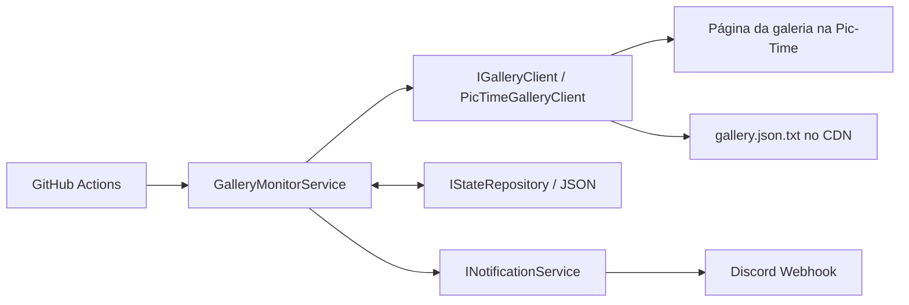

# Gallery Monitor

Aplicação de console em .NET 9 que consulta galerias públicas da Pic-Time, mantém um estado JSON versionado e avisa em um webhook do Discord quando surgem fotos ou vídeos novos. A cada execução é enviada uma única mensagem (embed) por galeria, com a quantidade de fotos e vídeos novos agrupada por cena, a prévia da primeira foto nova e o link para a galeria. Várias galerias podem ser acompanhadas apenas pela configuração.

## Arquitetura



`GalleryMonitorService` concentra o caso de uso; cliente, parser, repositório e notificadores só conhecem seus próprios contratos. Assim, um novo canal como Telegram, Slack ou e-mail é uma implementação adicional de `INotificationService`, sem alteração no serviço de monitoramento.

### Como a Pic-Time é lida

Não é preciso login nem cookies: tudo vem de requisições públicas.

1. O HTML da página da galeria declara `initParams` (com `projectId`, `projectStorageId`, `projectPathToken` e `galleryTimeStamp`) e `_pictimeStorageMapping`, que associa cada storage ao domínio do CDN.
2. Os dados da galeria ficam em:

   ```text
   {cdn}/pictures/{id/1e6}/{id/1e3%1000}/{id}/{token}/gallery.json.txt?ts={galleryTimeStamp}
   ```

   em que `id` é o `projectId` e `token` é o `projectPathToken`.
3. No JSON, `scenes[].photos` é um array plano com passo 5; o primeiro valor de cada grupo é um deslocamento e o id da foto é `minId + deslocamento`. Os ids listados em `rstPhotos` (também deslocamentos sobre `minId`) são ignorados.
4. Os vídeos são os itens de `scenes[].embedding` com `type` 80 que não estão ocultos.

A prévia enviada ao Discord é a versão `lowres/{id}.jpg` da primeira foto nova. Toda essa leitura está isolada em `PicTimeParser`.

### Diferenças em relação ao TrackingSky

- Uma mensagem agregada por galeria a cada execução, em vez de uma por evento.
- Notifica primeiro e só depois salva o estado: se a notificação falhar, as novidades são reenviadas na próxima execução.
- O estado é um conjunto monotônico de ids já vistos, então fotos ocultadas e republicadas não geram nova notificação.
- O webhook só é lido do secret/variável de ambiente; nunca fica em `appsettings.json`. Sem webhook, uma execução com novidades falha em vez de descartá-las.

## Tecnologias

- .NET 9, C# 13, Generic Host, DI, `IHttpClientFactory`, Options e `ILogger`.
- `System.Text.Json` para a leitura da galeria e para o estado.
- xUnit, FluentAssertions e Moq nos testes unitários.

## Estrutura

```text
src/GalleryMonitor/Clients/        acesso HTTP à página e ao JSON da galeria
src/GalleryMonitor/Parsers/        leitura do formato da Pic-Time
src/GalleryMonitor/Services/       caso de uso do monitoramento
src/GalleryMonitor/Notifications/  notificadores (Discord)
tests/GalleryMonitor.Tests/        testes unitários
.github/workflows/gallery.yml      automação agendada
data/gallery-state.json            estado criado na primeira execução
```

## Configuração local

1. Instale o SDK .NET 9.
2. Defina o segredo sem gravá-lo no repositório:

   ```powershell
   $env:DISCORD_WEBHOOK_URL = "https://discord.com/api/webhooks/..."
   ```

3. Ajuste `src/GalleryMonitor/appsettings.json`. Para adicionar uma galeria, acrescente um item em `Gallery:Items` com `Name` único e `Url` absoluta:

   ```json
   { "Name": "Giovana e Arthur", "Url": "https://ostorres.pic-time.com/-giovana-e-arthur1/gallery" }
   ```

4. Execute:

   ```powershell
   dotnet restore
   dotnet test
   dotnet run --project src/GalleryMonitor
   ```

Também é possível sobrescrever configurações com variáveis de ambiente seguindo `__`, por exemplo `Gallery__StateFilePath`. O webhook aceita diretamente `DISCORD_WEBHOOK_URL`.

Na primeira execução de cada galeria, o estado é salvo como linha de base e nenhuma mensagem é enviada. Nas seguintes, todas as fotos e vídeos ainda ausentes no estado entram em uma única mensagem.

## GitHub Actions e estado

O workflow executa a cada quinze minutos (o GitHub pode atrasar execuções agendadas em horários de pico) e também pode ser iniciado manualmente em **Actions → Gallery monitor → Run workflow**. Ele restaura, compila, testa, publica, executa e faz commit de `data/gallery-state.json` quando há alteração. Por isso, o repositório precisa permitir escrita para o `GITHUB_TOKEN`; o workflow já declara `contents: write`. Execuções concorrentes são enfileiradas para não disputarem o arquivo de estado.

Para configurar o webhook: abra o repositório no GitHub, vá a **Settings → Secrets and variables → Actions → New repository secret**, use `DISCORD_WEBHOOK_URL` como nome e cole a URL do webhook como valor. No Discord, crie-o em **Server Settings → Integrations → Webhooks → New Webhook** e copie a URL.

## Troubleshooting

- **GalleryParserException:** a página ou o JSON não estão no formato esperado — a Pic-Time mudou o formato ou a galeria passou a ser privada/protegida por senha. Ajuste apenas `PicTimeParser`.
- **Falha HTTP da galeria:** a execução termina com código diferente de zero e o arquivo de estado existente não é modificado.
- **Discord 429:** o serviço respeita `Retry-After` quando fornecido e tenta novamente com backoff exponencial, até `MaxRetries`.
- **"o webhook do Discord não está configurado":** havia novidades e o secret `DISCORD_WEBHOOK_URL` está ausente; a execução falha e o estado não avança, então nada se perde depois de configurá-lo.
- **Sem notificações:** lembre-se que a primeira execução de cada galeria é silenciosa (linha de base).
